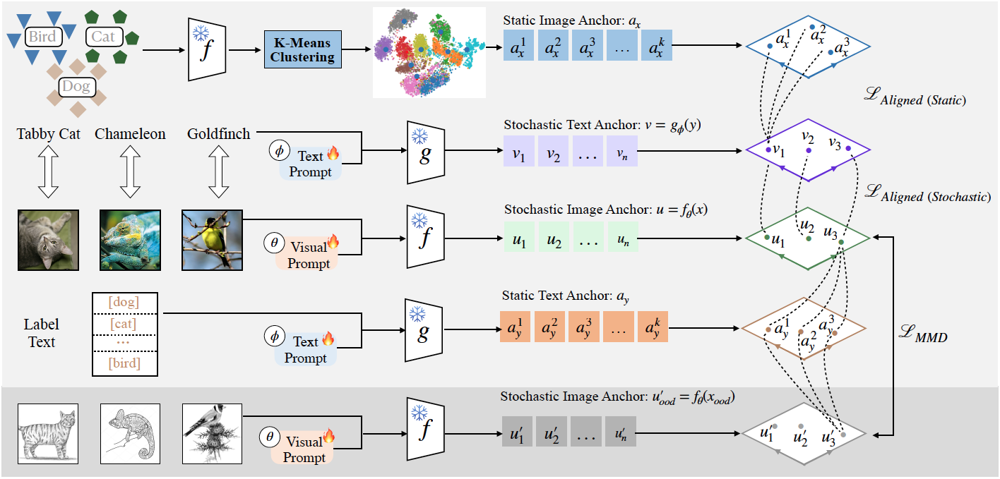

<div align="center">
<h1> [WACV 2025] Craft: Cross-modal Aligned Features Improve Robustness of Prompt Tuning </h1>

[Jingchen Sun](https://jingchensun.github.io/)<sup>*</sup>, Rohan Sharma, [Vishnu Suresh Lokhande](https://vlokhande-ub.github.io/)<sup>*</sup>, [Changyou Chen](https://cse.buffalo.edu/~changyou/)

University at Buffalo, SUNY &nbsp;&nbsp; <sup>*</sup> Corresponding authors


[](https://jingchensun.github.io/Craft/)
[](https://github.com/Jingchensun/Craft)
[](https://arxiv.org/abs/2407.15894) [](https://opensource.org/licenses/MIT)
</div>

## Introduction
We propose a novel cross-modal feature alignment method that mitigates the overfitting issue in visual-language model prompt tuning across different domains. [[Paper](https://openaccess.thecvf.com/content/WACV2025/html/Sun_Cross-Modal_Feature_Alignment_and_MMD_Improve_Robustness_of_Prompt_Tuning_WACV_2025_paper.html)] [[Project Page](https://jingchensun.github.io/Craft/)]
<div align="center">

</div>

## Installation

This codebase is tested on Ubuntu 20.04.2 LTS with python 3.8. Follow the below steps to create environment and install dependencies.


* Setup conda environment (recommended).
```bash
# Create a conda environment
conda create -y -n craft python=3.8

# Activate the environment
conda activate craft

# Install torch (requires version >= 1.8.1) and torchvision
pip install torch==2.0.0 torchvision==0.15.1 torchaudio==2.0.1 --index-url https://download.pytorch.org/whl/cu118
```


* Clone this code repository and install requirements
```bash
# Clone MaPLe code base
git clone git@github.com:Jingchensun/Craft.git

cd Craft
# Install requirements

pip install -r requirements.txt

# Update setuptools package 
pip install setuptools==59.5.0
```

* Install Dassl Library.
```bash
# Instructions borrowed from https://github.com/KaiyangZhou/Dassl.pytorch#installation

# Clone this repo
git clone git@github.com:Jingchensun/Dassl.pytorch.git
cd Dassl.pytorch/

# Install dependencies
pip install -r requirements.txt

# Install this library (no need to re-build if the source code is modified)
python setup.py develop
cd ..
```

## 1 Dataset Download

Following the Instruction of CoOp to download the 11 classfication [DATASETS](https://github.com/KaiyangZhou/CoOp/blob/main/DATASETS.md)

## 2 Prepare the Static Anchors
Save all the image features to the cache.
```bash
cd lpclip
bach maple.sh
```

Using K-Means to select the static anchor of image features.
```bash
cd lpclip
python static_anchor.py
```
## 3 Training and Evaluation

The default training settings are provided in config file at `configs/trainers/MaPLe/vit_b16_c2_ep5_batch4_2ctx.yaml`. All hyper-parameters such as prompt length, prompt depth, etc., can be modified using this config file. 

<!-- When `DATASET.SUBSAMPLE_CLASSES` in the scripts is set as `ALL`, that is used for in distribution setting; when `DATASET.SUBSAMPLE_CLASSES` is set as `Base`, that is used for out of distribution setting. -->


```bash
bach maple.sh
```

## 4 OOD Training and Evaluation

```bash
bach maple_ood.sh
```

#### Averaging results over 3 seeds: 
Once the above trainings and evaluations are completed, the `output/` directory should have the following structure:

```
output
|–– base2new/
|   |–– test_new/
|   |   |–– imagenet/
|   |   |   |–– shots_16/
|   |   |   |   |–– MaPLe/
|   |   |   |   |   |–– vit_b16_c2_ep5_batch4_2ctx/
|   |   |   |   |   |   |–– seed1/
|   |   |   |   |   |   |–– seed2/
|   |   |   |   |   |   |–– seed3/
|   |–– train_base/
|   |   |–– imagenet/
|   |   |   |–– shots_16/
|   |   |   |   |–– MaPLe/
|   |   |   |   |   |–– vit_b16_c2_ep5_batch4_2ctx/
|   |   |   |   |   |   |–– seed1/
|   |   |   |   |   |   |–– seed2/
|   |   |   |   |   |   |–– seed3/
```

Now use the script `parse_test_res.py` and run the commands below to calculate the averaged results:
```bash
python utils/acc_info.py
```
The evaulation result will save to acc.json file.


## Acknowledgements

Our code is based on [CoOp](https://github.com/KaiyangZhou/CoOp), [Maple](https://github.com/muzairkhattak/multimodal-prompt-learning) and [PromptSRC](https://github.com/muzairkhattak/PromptSRC) repository. We thank the authors for releasing their code. 

## Citing Craft

If you find this repository useful, please consider giving a star :star: and citation

```
@article{sun2024craft,
  title={Craft: Cross-modal Aligned Features Improve Robustness of Prompt Tuning},
  author={Sun, Jingchen and Sharma, Rohan and Lokhande, Vishnu Suresh and Chen, Changyou},
  journal={arXiv preprint arXiv:2407.15894},
  year={2024}
}
```